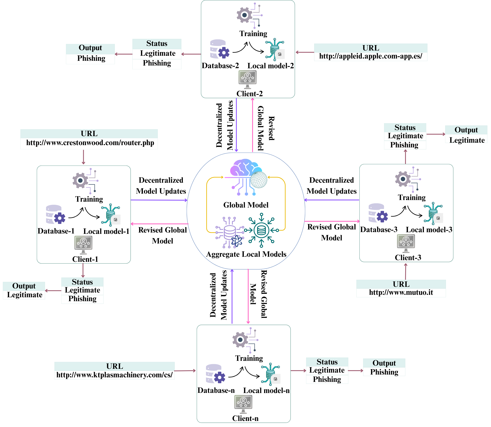

# URLAegis: An Explainable Federated Learning Framework for Phishing URL Detection

URLAegis is an explainable federated learning (FL) framework for phishing URL detection. It combines five deep learning architectures, three federated learning aggregation strategies, and explainable artificial intelligence (XAI) techniques to evaluate phishing URL detection across four benchmark datasets.

The framework investigates model performance across different datasets and aggregation strategies while using SHAP and LIME to interpret model predictions.

## Framework Overview

The following figure presents the overall architecture of the proposed URLAegis framework for phishing URL detection.



*Figure 1. Schematic representation of the proposed URLAegis framework for phishing URL detection.*

## Key Features

- Federated learning-based phishing URL detection.
- Evaluation of five deep learning architectures.
- Comparison of FedAvg, FedProx, and Modified SCAFFOLD.
- Experiments on four phishing URL benchmark datasets.
- Model interpretability using SHAP and LIME.
- Comparative analysis of predictive performance across datasets and model configurations.

## Deep Learning Models

The framework evaluates the following five deep learning architectures:

1. **1DCNN**: One-dimensional convolutional neural network.
2. **LSTM**: Long Short-Term Memory network.
3. **GRU**: Gated Recurrent Unit network.
4. **BiGRU**: Bidirectional Gated Recurrent Unit network.
5. **BiLSTM**: Bidirectional Long Short-Term Memory network.

## Federated Learning Algorithms

Three federated learning strategies are evaluated:

- **FedAvg (Federated Averaging):** Aggregates locally trained model parameters to construct the global model.
- **FedProx:** Incorporates a proximal term into local optimization to help address heterogeneity among clients.
- **Modified SCAFFOLD:** Uses a modified control-variate-based approach to address client drift during federated training.

Modified SCAFFOLD refers to the variant implemented and evaluated in this study. It should not be interpreted as an exact implementation of the original SCAFFOLD algorithm.

## Datasets

URLAegis is evaluated using four phishing URL datasets:

- **Mendeley**
- **PhiUSIIL**
- **LegitPhish**
- **URL-Phish**

Each dataset is evaluated using the experimental setup described in the associated manuscript.

## Explainable Artificial Intelligence

URLAegis integrates two explainability methods to help interpret model predictions.

### SHAP

SHAP (SHapley Additive exPlanations) is used to analyze feature contributions to model predictions and identify influential features.

### LIME

LIME (Local Interpretable Model-agnostic Explanations) is used to generate local explanations for individual predictions.

Together, these methods provide complementary perspectives on model behavior and support the interpretation of phishing URL classification decisions.

## Best Reported Results

The following table summarizes the best-performing model and federated learning strategy reported for each dataset in the manuscript.

| Dataset | Federated Algorithm | Best Model | Accuracy |
|---|---|---|---:|
| Mendeley | Modified SCAFFOLD | BiLSTM | 97.16% |
| PhiUSIIL | Modified SCAFFOLD | BiGRU | 99.99% |
| LegitPhish | Modified SCAFFOLD | LSTM | 99.91% |
| URL-Phish | Modified SCAFFOLD | BiGRU | 98.53% |

These are the best reported dataset-specific accuracy values from the study. They should be interpreted in the context of the datasets, model configurations, and experimental settings described in the manuscript.

## Research Paper

**Title:** URLAegis: An Explainable Federated Learning Framework for Phishing URL Detection

**Preprint:** [Read the paper on SSRN](https://papers.ssrn.com/sol3/papers.cfm?abstract_id=6890046)

**DOI:** [10.2139/ssrn.6890046](https://doi.org/10.2139/ssrn.6890046)

### Citation

If you use this work in your research, please cite the associated preprint.

```bibtex
@article{mahi2026urlaegis,
  title   = {URLAegis: An Explainable Federated Learning Framework for Phishing URL Detection},
  author  = {Mahi, Abu Bakar Siddique and Mowla, Tasnim Jahin and Mahima, Sanjida Siddiqa and Mridula, Danastan Tasaouf and Islam, Md. Rajibul and Rahaman, Muhammad Aminur and Mehedi, Sk Tanzir},
  year    = {2026},
  doi     = {10.2139/ssrn.6890046},
  url     = {https://papers.ssrn.com/sol3/papers.cfm?abstract_id=6890046}
}
```

## Authors

1. **Abu Bakar Siddique Mahi**  
   Affiliation: Bangladesh University of Business and Technology (BUBT)  
   ORCID: [0009-0002-8696-0469](https://orcid.org/0009-0002-8696-0469)

2. **Tasnim Jahin Mowla**  
   Affiliation: University of Asia Pacific (UAP)  
   ORCID: [0009-0003-8325-0493](https://orcid.org/0009-0003-8325-0493)

3. **Sanjida Siddiqa Mahima**  
   Affiliation: University of Asia Pacific (UAP)  
   ORCID: [0009-0001-9310-0937](https://orcid.org/0009-0001-9310-0937)

4. **Danastan Tasaouf Mridula**  
   Affiliation: Northern University Bangladesh  
   ORCID: [0009-0000-0547-0261](https://orcid.org/0009-0000-0547-0261)

5. **Md. Rajibul Islam**  
   Affiliation: Bangladesh University of Business and Technology (BUBT)  
   ORCID: [0000-0003-0565-6917](https://orcid.org/0000-0003-0565-6917)

6. **Muhammad Aminur Rahaman**  
   Affiliation: Bangladesh University of Business and Technology (BUBT)  
   ORCID: [0000-0002-7399-5876](https://orcid.org/0000-0002-7399-5876)

7. **Sk Tanzir Mehedi**  
   Affiliation: Queensland University of Technology (QUT)  
   ORCID: [0000-0003-4435-7856](https://orcid.org/0000-0003-4435-7856)

## Contact

For questions regarding the research, please contact:

- **Abu Bakar Siddique Mahi:** [absmahi@bubt.edu.bd](mailto:absmahi@bubt.edu.bd)
- **Corresponding author, Sk Tanzir Mehedi:** [s.tanzir@qut.edu.au](mailto:s.tanzir@qut.edu.au)

## License

This project is intended to be released under the MIT License. Please refer to the repository's `LICENSE` file for the complete terms and conditions.

## Disclaimer

This repository accompanies the URLAegis research work. The reported results reflect the experimental settings and datasets described in the associated manuscript.

Federated learning alone does not guarantee formal privacy or security. Unless explicitly implemented and documented in the code, this project should not be interpreted as providing differential privacy, homomorphic encryption, or secure aggregation.

For research use, please cite the associated preprint.
